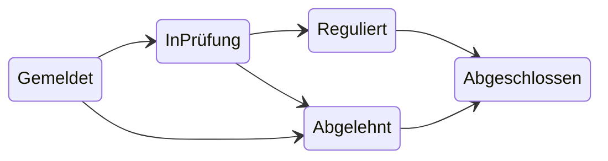

# Schadenverwaltung
Kleine Schadenverwaltung als ASP.NET Core Web API mit EF Core und PostgreSQL, Lern- und Portfolioprojekt.
Die Versicherungsdomäne ist generisch und frei erfunden.

## Stand
**Etappe 2 abgeschlossen:** Web-API mit PostgreSQL, Verträge und Schäden anlegen und lesen, Statuswechsel per API.
Zahlungen und Abrechnung folgen in Etappe 3.

## Fachbegriffe
| Begriff | Im Code | Bedeutung |
|---|---|---|
| Vertrag | `Contract` | Versicherungsvertrag mit Sparte, Beginn und Status |
| Schaden | `Claim` | Gemeldeter Schadenfall zu einem Vertrag |
| Zahlung | `Payment` | Auszahlung auf einen Schaden |
| Reserve | `Reserve` | Erwarteter Gesamtaufwand für einen Schaden |

## Schadenstatus

Andere Wechsel lehnt der Schaden selbst ab, die API antwortet dann mit 409.

## Umgesetzte Fachregeln
- **Gültige Objekte:** Verträge, Schäden und Zahlungen lassen sich nur mit gültigen Werten erzeugen.
- **Statusübergänge:** nur die Wechsel aus dem Diagramm oben.
- **Zahlungssperre:** keine Zahlung auf abgelehnte oder abgeschlossene Schäden.
- **Reservewarnung:** Übersteigen die Zahlungen die Reserve, wird trotzdem gebucht, das Ergebnis enthält aber eine Warnung.
- **Nummernvergabe:** Vertragsnummern (`V-000001`) und Schadennummern (`S-2026-000001`) über Datenbank-Sequenzen.

## Endpunkte
| Methode | Pfad | Zweck |
|---|---|---|
| GET | `api/contracts` | Alle Verträge |
| GET | `api/contracts/{id}` | Einzelner Vertrag |
| POST | `api/contracts` | Vertrag anlegen |
| GET | `api/claims` | Alle Schäden |
| GET | `api/claims/{id}` | Einzelner Schaden |
| POST | `api/claims` | Schaden zu einem Vertrag anlegen |
| PATCH | `api/claims/{id}/status` | Status eines Schadens wechseln |

Fehler kommen einheitlich als `ProblemDetails`: 400 bei ungültiger Eingabe, 404 bei unbekannter ID,
409 bei verbotenem Statuswechsel.

## Technik
- .NET 10, C#, ASP.NET Core Web API mit Controllern
- EF Core 10 mit PostgreSQL 18 (Docker Compose), Migrationen im Repo
- OpenAPI mit Swagger UI
- xUnit für Unit-Tests
- Nullable Reference Types, Warnungen gelten als Fehler (`Directory.Build.props`)

## Architekturentscheidungen
- **PostgreSQL:** Damit habe ich schon gearbeitet und wollte meinen Umgang damit auffrischen; kostenlos und verbreitet.
- **Controller statt Minimal APIs:** Controller waren mir bereits ein Begriff.
- **Schichten Domain / Infrastructure / Api:** Klare Kapselung nach Verwendungszweck, keine Fachlogik in der API.
  Die Domain kennt weder Datenbank noch Web und lässt sich ohne beides testen.

## Projektstruktur
```
src/
  Schadenverwaltung.Api/             Web-API: Controller, DTOs, Mapping
  Schadenverwaltung.Domain/          Fachmodell und Regeln, ohne Abhängigkeiten
  Schadenverwaltung.Infrastructure/  EF Core, Konfigurationen, Migrationen, Nummernvergabe
tests/
  Schadenverwaltung.Tests/
```

## Starten
Voraussetzungen: .NET 10 SDK, Docker mit Compose.

1. `.env` im Repo-Root mit dem Datenbank-Passwort anlegen (Variable siehe `docker-compose.yml`), dann die Datenbank starten:
   ```bash
   docker compose up -d
   ```
2. Connection String als User Secret setzen:
   ```bash
   dotnet user-secrets set "ConnectionStrings:Default" \
     "Host=localhost;Port=5432;Database=schadenverwaltung;Username=schadenverwaltung;Password=<Passwort>" \
     --project src/Schadenverwaltung.Api
   ```
3. Werkzeuge holen und Datenbank anlegen:
   ```bash
   dotnet tool restore
   dotnet ef database update --project src/Schadenverwaltung.Infrastructure --startup-project src/Schadenverwaltung.Api
   ```
4. API starten und im Browser `/swagger` öffnen:
   ```bash
   dotnet run --project src/Schadenverwaltung.Api
   ```

## Bauen und testen
```bash
dotnet build
dotnet test
```
